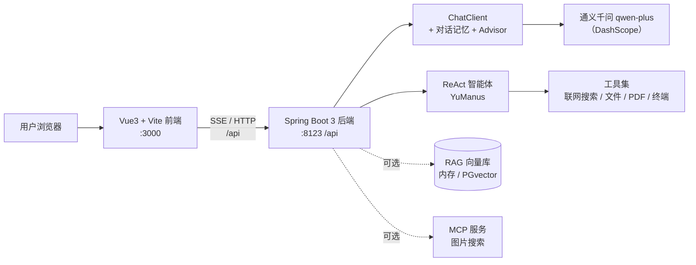

# 灵盾 SecMind — AI 网络安全助手

> 基于 Spring Boot 3 + Spring AI 的企业级 AI 网络安全助手，提供安全学习、漏洞分析、应急响应与防护加固建议；内置基于 ReAct 模式的自主规划智能体，支持多轮对话记忆与 SSE 流式响应。

## 一、项目简介

灵盾 SecMind 是一个以 AI 为核心的网络安全智能体项目。用户可通过类 ChatGPT 的对话界面，向「AI 网络安全助手」咨询安全原理、漏洞分析、应急响应等问题；助手会引导用户描述现象与影响范围，给出条理清晰的分析步骤、处置建议和防范方案。另一个「AI 全能助手」基于 ReAct 模式，可自主拆解任务、调用工具直到完成目标。

## 二、系统架构



## 三、功能模块

| 模块 | 说明 | 当前状态 |
|---|---|---|
| AI 网络安全助手 | 自定义系统提示词，以资深安全工程师身份回答安全学习、漏洞分析、应急响应、防护加固问题 | 已实现 |
| 多轮对话记忆 | 基于 MessageWindowChatMemory 保持上下文连贯 | 已实现（内存） |
| SSE 流式响应 | 后端 Flux 推送，前端打字机效果实时展示 | 已实现 |
| AI 全能助手 | 基于 ReAct 的自主规划智能体，可调用工具循环执行 | 已实现 |
| RAG 知识库 | 文档加载、切片、向量化与检索增强 | 代码已具备，待替换为安全领域文档 |
| 工具调用 Tool Calling | 联网搜索、文件操作、网页抓取、终端、资源下载、PDF 生成 | 代码已具备，需配置对应 API Key |
| MCP 服务 | 图片搜索 MCP（Stdio / SSE） | 子项目已具备，需单独启动 |
| 本地大模型 | Ollama 本地部署，降低延迟与成本、保障数据安全 | 待本地安装 Ollama |

## 四、技术选型

**后端**

- Java 21 + Spring Boot 3.x
- Spring AI / Spring AI Alibaba（ChatClient、Advisor、ChatMemory、结构化输出、RAG、Tool Calling、MCP）
- 阿里云百炼 DashScope（通义千问 qwen-plus）
- SSE（Flux / SseEmitter）异步流式
- Hutool、Lombok、Knife4j、Jsoup、iText、Kryo
- Docker 容器化、Serverless 部署

**前端**

- Vue 3 + Vite + Vue Router + Axios
- @vueuse/head 管理页面元信息
- SSE 流式消费与打字机效果
- 深色科技风界面，响应式布局

## 五、目录结构

```
yu-ai-agent/
├── src/main/java/com/yupi/yuaiagent/
│   ├── controller/      # AiController、HealthController
│   ├── app/             # 安全助手应用（系统提示词、对话、RAG、工具、MCP）
│   ├── agent/           # BaseAgent / ReActAgent / ToolCallAgent / YuManus
│   ├── advisor/         # 自定义日志、推理增强 Advisor
│   ├── chatmemory/      # 基于文件的对话记忆
│   ├── rag/             # RAG 配置、文档加载、查询改写、向量库
│   ├── tools/           # 各类工具与集中式注册
│   └── config/          # 跨域等配置
├── src/main/resources/
│   ├── application.yml  # 仓库内配置（密钥用环境变量占位）
│   └── document/        # RAG 文档（示例，待替换为安全文档）
├── config/              # 外部运行配置（已 gitignore，存放真实密钥）
├── yu-ai-agent-frontend/   # Vue3 前端工程
└── yu-image-search-mcp-server/  # 图片搜索 MCP 子项目
```

## 六、快速开始

### 环境要求

- JDK 21、Maven（项目自带 mvnw）
- Node.js 18+ 与 npm
- 一个 DashScope API Key（sk- 开头，阿里云百炼控制台获取）

### 后端（端口 8123）

1. 在项目根创建 `config/application.yml`（该文件已被 gitignore），填入真实 Key：

```yaml
spring:
  ai:
    dashscope:
      api-key: sk-你的真实Key
      chat:
        options:
          model: qwen-plus
server:
  port: 8123
  servlet:
    context-path: /api
```

2. 编译并启动：

```bash
./mvnw -DskipTests package
java -jar target/yu-ai-agent-0.0.1-SNAPSHOT.jar
```

3. 健康检查：访问 `http://localhost:8123/api/health` 返回 `ok`

### 前端（端口 3000）

```bash
cd yu-ai-agent-frontend
npm install
npm run dev
```

浏览器访问 `http://localhost:3000`，即可看到落地页与两个入口。

## 七、密钥与安全说明

- 仓库内 `src/main/resources/application.yml` 使用环境变量占位 `${DASHSCOPE_API_KEY:sk-请替换为你的API Key}`，**不包含真实密钥**。
- 真实 Key 仅放在被 `.gitignore` 忽略的 `config/application.yml`，或通过环境变量 `DASHSCOPE_API_KEY` 注入。
- 提交前务必确认 `config/`、`logs/` 已被忽略（`git check-ignore -v config/application.yml`）。
- 若 Key 曾意外提交或泄露，应立即在云平台禁用并轮换。

## 八、后续扩展方向（提升区分度）

1. 将 RAG 文档替换为网络安全领域资料（等保、应急响应、漏洞库），实现安全知识库问答。
2. 接入 PGvector 向量数据库，替换内存存储。
3. 配置联网搜索 / PDF 工具，让智能体自动生成安全分析报告。
4. 基于 Ollama 接入本地模型，处理敏感内网场景。
5. 完善 MCP 服务并发布到 MCP 市场。
